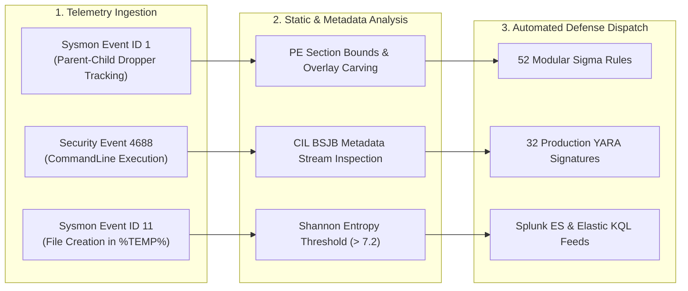

<div align="center">

<p align="center">
  <strong>🇺🇸 English</strong> · <a href="./docs/locales/ko.md">🇰🇷 한국어</a> · <a href="./docs/locales/zh-CN.md">🇨🇳 中文</a> · <a href="./docs/locales/es.md">🇪🇸 Español</a> · <a href="./docs/locales/hi.md">🇮🇳 हिन्दी</a><br />
  <a href="./docs/locales/ar.md">🇸🇦 العربية</a> · <a href="./docs/locales/pt-BR.md">🇧🇷 Português</a> · <a href="./docs/locales/ru.md">🇷🇺 Русский</a> · <a href="./docs/locales/fr.md">🇫🇷 Français</a> · <a href="./docs/locales/id.md">🇮🇩 Bahasa Indonesia</a>
</p>

<p align="center">
  <a href="https://github.com/maya-thorne/dotnet-obfuscation-and-ghidra-re"></a>
</p>

# 🛡️ dotnet-obfuscation-and-ghidra-re

**Blue Team EDR/SIEM Detection Engineering, 52 Sigma Rules, 32 YARA Signatures, CIL Metadata Forensics & Ghidra Binary RE Suite**

[](https://github.com/maya-thorne/dotnet-obfuscation-and-ghidra-re/releases/latest)
[](./rules/sigma)
[](./rules/yara)
[](./rules/siem_queries)
[](./docs/MITRE_ATTACK_DEFENSE_MATRIX.md)
[](./tests)
[](./LICENSE)

<sub>Engineered &amp; Audited by **[Maya Thorne](https://github.com/maya-thorne)** · Systems &amp; Reverse Engineering Research</sub>

</div>

---

## 📌 Executive Overview

Managed .NET assemblies compile to Common Intermediate Language (CIL/MSIL) and CLI metadata rather than native machine code. While beneficial for cross-platform portability and JIT optimizations, this architecture exposes full source code, types, and control flow graphs to decompilers such as dnSpy, ILSpy, and dotPeek.

To circumvent static inspection, red teams and threat actors employ advanced protectors:
1. **dnlib-based obfuscators** (e.g., ConfuserEx) introducing JIT method encryption (`AntiTamper`), memory wiping (`AntiDump`), and corrupted `#~` table stream headers (`InvalidMetadata`).
2. **Commercial protectors** (.NET Reactor, Babel, Eazfuscator, ArmDot) deploying native loaders and custom virtual machines.
3. **PE overlay injectors** (e.g., `xorPacker` / `xorStub`) appending XOR-ciphered executables beyond physical PE section bounds to execute dropped payloads in memory or temporary user folders.

This repository provides an **enterprise-grade defensive security engineering lab and SOC/EDR detection suite** designed to detect, classify, and reverse these evasion techniques without executing untrusted binaries.

---

## 🏛️ System Architecture & Analysis Pipeline

<details open>
<summary><b>🏛️ View System Architecture &amp; Analysis Pipeline (Click to collapse/expand)</b></summary>
<br>

<p align="center">
  <a href="https://github.com/maya-thorne/dotnet-obfuscation-and-ghidra-re"></a>
</p>

The framework implements a four-stage pipeline:
- **Stage 1 (Binary Triage)**: Parses DOS and NT headers, validates section bounds, and calculates section-by-section Shannon entropy.
- **Stage 2 (Metadata Audit)**: Parses CLI Header, BSJB root signature, and `#Strings`, `#US`, `#Blob`, `#GUID`, and `#~` streams, flagging anomalous offsets.
- **Stage 3 (Cipher Inversion)**: Automatically scans for overlay delimiters (`***`), inverts master-key XOR ciphers, and restores valid payload binaries.
- **Stage 4 (Blue Team Dispatch)**: Feeds indicators into 52 modular Sigma rules and 32 YARA signatures ready for Splunk and Elasticsearch deployment.
</details>

---

## 🏗️ Blue Team EDR/SIEM Detection Pipeline

<details open>
<summary><b>🏗️ View Blue Team EDR/SIEM Detection Pipeline (Click to collapse/expand)</b></summary>
<br>

<p align="center">
  <a href="https://github.com/maya-thorne/dotnet-obfuscation-and-ghidra-re"></a>
</p>


</details>

---

## 💻 Interactive Forensic Terminal Demonstration

<details open>
<summary><b>💻 View Interactive Forensic Terminal Demonstration (Click to collapse/expand)</b></summary>
<br>

<p align="center">
  
</p>
</details>

---

## 📚 Core Research Whitepapers

<details open>
<summary><b>📚 View 4 Core .NET CIL &amp; Packer Forensic Whitepapers</b></summary>
<br>

<table width="100%">
  <thead>
    <tr>
      <th width="32%">Research Document</th>
      <th width="68%">Technical Scope &amp; Target Systems</th>
    </tr>
  </thead>
  <tbody>
    <tr>
      <td>
        🔬 <strong><a href="./docs/whitepapers/01_DOTNET_CIL_METADATA_AND_JIT_FORENSICS.md">01_DOTNET_CIL_METADATA_AND_JIT_FORENSICS.md</a></strong><br>
        <code>01_DOTNET_CIL_METADATA_AND_JIT_FORENSICS.md</code>
      </td>
      <td>
        ECMA-335 CLI file header specifications, metadata stream layouts (#Strings, #US, #Blob), and Invalid Metadata exploitation crashing decompilers.
      </td>
    </tr>
    <tr>
      <td>
        🔬 <strong><a href="./docs/whitepapers/02_CONFUSEREX_8_PHASE_EVASION_DECONSTRUCTION.md">02_CONFUSEREX_8_PHASE_EVASION_DECONSTRUCTION.md</a></strong><br>
        <code>02_CONFUSEREX_8_PHASE_EVASION_DECONSTRUCTION.md</code>
      </td>
      <td>
        Decompilation and source disassembly of ConfuserEx: AntiTamper JIT compilation hooking, AntiDump memory erasure, and control flow flattening.
      </td>
    </tr>
    <tr>
      <td>
        🔬 <strong><a href="./docs/whitepapers/03_NATIVE_PACKER_PE_OVERLAY_AND_STUB_RE.md">03_NATIVE_PACKER_PE_OVERLAY_AND_STUB_RE.md</a></strong><br>
        <code>03_NATIVE_PACKER_PE_OVERLAY_AND_STUB_RE.md</code>
      </td>
      <td>
        Ghidra MCP reverse engineering of xorStub.exe, PE overlay carving, 2-stage XOR inversion algorithms, and Themida native virtualization stubs.
      </td>
    </tr>
    <tr>
      <td>
        🔬 <strong><a href="./docs/whitepapers/04_COMMERCIAL_OBFUSCATOR_TAXONOMY_AND_HEURISTICS.md">04_COMMERCIAL_OBFUSCATOR_TAXONOMY_AND_HEURISTICS.md</a></strong><br>
        <code>04_COMMERCIAL_OBFUSCATOR_TAXONOMY_AND_HEURISTICS.md</code>
      </td>
      <td>
        Comparative taxonomy, signature matrices, and detection heuristics across 8 commercial .NET protectors (.NET Reactor, Babel, Eazfuscator, ArmDot).
      </td>
    </tr>
  </tbody>
</table>
</details>

---

## 🛠️ CLI Quickstart Guide

<details open>
<summary><b>🛠️ View CLI Installation, Analysis &amp; Test Execution Commands</b></summary>
<br>

### Installation & Execution
```bash
# Clone the repository
git clone https://github.com/maya-thorne/dotnet-obfuscation-and-ghidra-re.git
cd dotnet-obfuscation-and-ghidra-re

# Run forensic analysis on sample binary
python -m src.cli target.exe -v

# Export forensic report to JSON
python -m src.cli target.exe --json report.json

# Carve PE overlay or unpack XOR-ciphered payload
python -m src.cli target.exe --extract-overlay overlay.bin --unpack-payload unpacked.exe
```

### Running Automated Test Suite
```bash
python -m unittest discover tests
```
</details>

---

## 🛡️ MITRE ATT&CK Defense Mapping

<details>
<summary><b>🛡️ View MITRE ATT&CK Enterprise Matrix Mapping &amp; Techniques</b></summary>
<br>

Complete enterprise technique mapping and defense rule references are available in [`docs/MITRE_ATTACK_DEFENSE_MATRIX.md`](./docs/MITRE_ATTACK_DEFENSE_MATRIX.md):
- **T1027 / T1027.002**: Software Packing & PE Overlays
- **T1055 / T1055.002**: Process Injection & Portable Executable Dropping
- **T1497 / T1497.001**: Virtualization / Sandbox System Checks
- **T1036 / T1036.005**: Masquerading & Hidden Console Windows
- **T1070 / T1070.004**: Indicator Removal & Self-Deleting Droppers
- **T1574 / T1574.010**: COR_PROFILER Hijacking
</details>

---

## 📜 License & Attribution

This software, research whitepapers, and detection rulesets are licensed under the **Maya Thorne Systems & Security Research License (MT-SRL)**.  
See [`LICENSE`](./LICENSE) for terms. Published strictly for defensive research, detection engineering, and malware analysis education.
