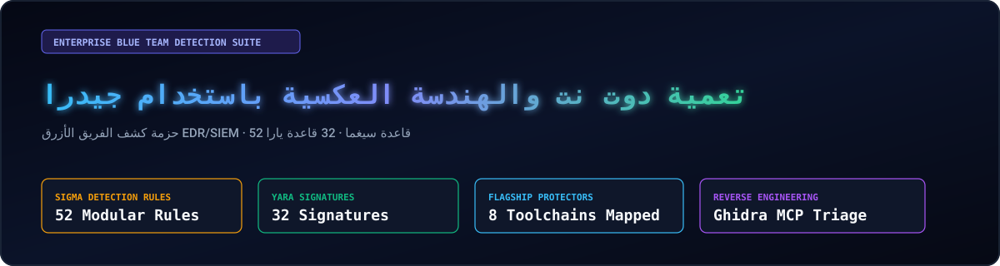
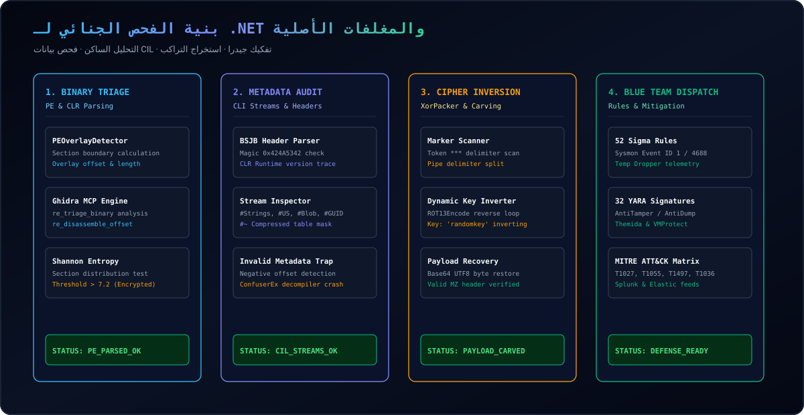
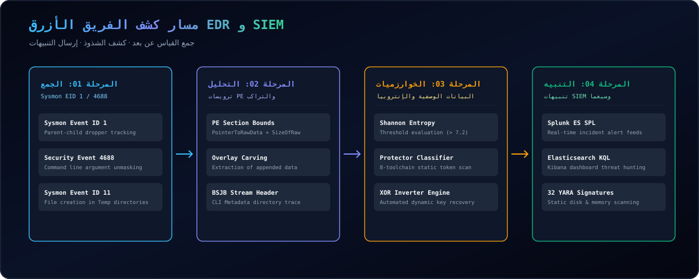
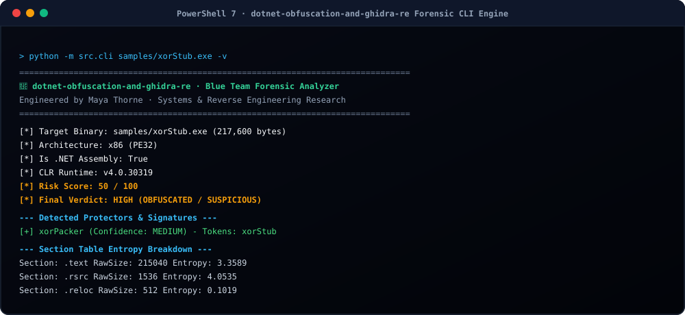

  <a href="../../README.md">🇺🇸 English</a> · <a href="./ko.md">🇰🇷 한국어</a> · <a href="./zh-CN.md">🇨🇳 中文</a> · <a href="./es.md">🇪🇸 Español</a> · <a href="./hi.md">🇮🇳 हिन्दी</a> 
  <a href="./ar.md">🇸🇦 العربية</a> · <a href="./pt-BR.md">🇧🇷 Português</a> · <a href="./ru.md">🇷🇺 Русский</a> · <a href="./fr.md">🇫🇷 Français</a> · <a href="./id.md">🇮🇩 Bahasa Indonesia</a>

  

# 🛡️ dotnet-obfuscation-and-ghidra-re

**هندسة كشف الفريق الأزرق EDR/SIEM، 52 قاعدة سيغما، 32 توقيع يارا، وحزمة الفحص الجنائي لـ .NET**

Engineered &amp; Audited by **[Maya Thorne](https://github.com/maya-thorne)** · Systems &amp; Reverse Engineering Research

---

## 📌 نظرة عامة

يتم تجميع تجميعات .NET في بايت كود CIL وبيانات CLI مما يجعلها عرضة للتفكيك. يستغل المهاجمون أدوات ConfuserEx و xorPacker لتجاوز الكشف الأمني.

توفر هذه الحزمة **إطار عمل دفاعي متكامل لمحللي مراكز العمليات الأمنية (SOC)** يتضمن 52 قاعدة سيغما و32 قاعدة يارا ومحرك فحص CIL متقدم.

---

## 🏛️ بنية النظام ومسار الفحص الجنائي

<b>🏗️ عرض مسار كشف EDR و SIEM (انقر للطي/التوسيع)</b>

 

  

---

## 🏗️ مسار كشف EDR/SIEM

<b>🏗️ عرض مسار كشف EDR و SIEM (انقر للطي/التوسيع)</b>

 

  

---

## 💻 عرض توضيحي للطرفية

  

---

## 📚 فهرس الأوراق البحثية

<table width="100%">
  <thead>
    <tr>
      <th width="32%">الورقة البحثية</th>
      <th width="68%">النطاق التقني وأهداف التحليل</th>
    </tr>
  </thead>
  <tbody>
    <tr>
      <td>
        🔬 <strong><a href="../whitepapers/01_DOTNET_CIL_METADATA_AND_JIT_FORENSICS.md">01_DOTNET_CIL_METADATA_AND_JIT_FORENSICS.md</a></strong> 
        <code>01_DOTNET_CIL_METADATA_AND_JIT_FORENSICS.md</code>
      </td>
      <td>
        هياكل ECMA-335، مسارات #Strings و #US واستغلال البيانات الوصفية غير الصالحة.
      </td>
    </tr>
    <tr>
      <td>
        🔬 <strong><a href="../whitepapers/02_CONFUSEREX_8_PHASE_EVASION_DECONSTRUCTION.md">02_CONFUSEREX_8_PHASE_EVASION_DECONSTRUCTION.md</a></strong> 
        <code>02_CONFUSEREX_8_PHASE_EVASION_DECONSTRUCTION.md</code>
      </td>
      <td>
        تفكيك آليات AntiTamper JIT و AntiDump في ConfuserEx.
      </td>
    </tr>
    <tr>
      <td>
        🔬 <strong><a href="../whitepapers/03_NATIVE_PACKER_PE_OVERLAY_AND_STUB_RE.md">03_NATIVE_PACKER_PE_OVERLAY_AND_STUB_RE.md</a></strong> 
        <code>03_NATIVE_PACKER_PE_OVERLAY_AND_STUB_RE.md</code>
      </td>
      <td>
        استخراج تراكب PE وتفكيك شفرة xorPacker ومغلفات Themida.
      </td>
    </tr>
    <tr>
      <td>
        🔬 <strong><a href="../whitepapers/04_COMMERCIAL_OBFUSCATOR_TAXONOMY_AND_HEURISTICS.md">04_COMMERCIAL_OBFUSCATOR_TAXONOMY_AND_HEURISTICS.md</a></strong> 
        <code>04_COMMERCIAL_OBFUSCATOR_TAXONOMY_AND_HEURISTICS.md</code>
      </td>
      <td>
        تصنيف وتواقيع 8 أدوات تعمية تجارية (.NET Reactor, Babel).
      </td>
    </tr>
  </tbody>
</table>

---

## 🛡️ مصفوفة الدفاع MITRE ATT&CK

Full MITRE ATT&CK matrix: [docs/MITRE_ATTACK_DEFENSE_MATRIX.md](../MITRE_ATTACK_DEFENSE_MATRIX.md)
