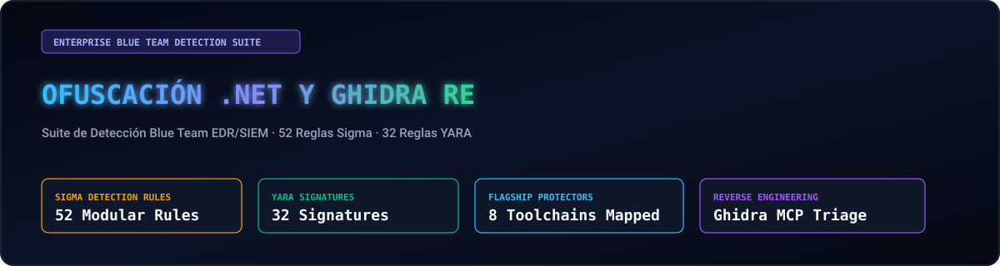
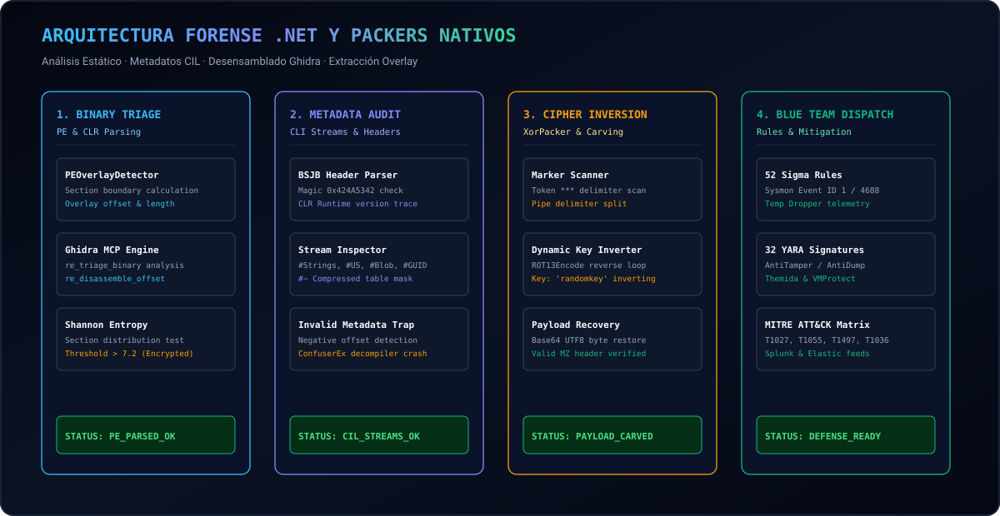
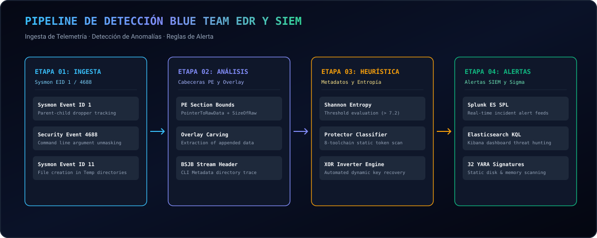

  <a href="../../README.md">🇺🇸 English</a> · <a href="./ko.md">🇰🇷 한국어</a> · <a href="./zh-CN.md">🇨🇳 中文</a> · <a href="./es.md">🇪🇸 Español</a> · <a href="./hi.md">🇮🇳 हिन्दी</a> 
  <a href="./ar.md">🇸🇦 العربية</a> · <a href="./pt-BR.md">🇧🇷 Português</a> · <a href="./ru.md">🇷🇺 Русский</a> · <a href="./fr.md">🇫🇷 Français</a> · <a href="./id.md">🇮🇩 Bahasa Indonesia</a>

  

# 🛡️ dotnet-obfuscation-and-ghidra-re

**Ingeniería de Detección Blue Team EDR/SIEM, 52 Reglas Sigma, 32 Reglas YARA, Análisis CIL y Suite Ghidra RE**

Engineered &amp; Audited by **[Maya Thorne](https://github.com/maya-thorne)** · Systems &amp; Reverse Engineering Research

---

## 📌 Resumen Ejecutivo

Los ensamblados .NET se compilan en CIL y metadatos CLI, exponiendo el código a descompiladores como dnSpy. Los adversarios utilizan ConfuserEx, .NET Reactor y xorPacker para evadir la detección.

Este repositorio proporciona una **suite de ingeniería de detección de nivel empresarial para analistas SOC/EDR**, con 52 reglas Sigma, 32 reglas YARA y motor forense de metadatos CIL.

---

## 🏛️ Arquitectura del Sistema y Pipeline Forense

  

---

## 🏗️ Pipeline de Detección EDR/SIEM

  

---

## 💻 Demostración en Terminal

  

---

## 📚 Índice de Whitepapers de Investigación

<table width="100%">
  <thead>
    <tr>
      <th width="32%">Documento de Investigación</th>
      <th width="68%">Alcance y Objetivos de Análisis</th>
    </tr>
  </thead>
  <tbody>
    <tr>
      <td>
        🔬 <strong><a href="../whitepapers/01_DOTNET_CIL_METADATA_AND_JIT_FORENSICS.md">01_DOTNET_CIL_METADATA_AND_JIT_FORENSICS.md</a></strong> 
        <code>01_DOTNET_CIL_METADATA_AND_JIT_FORENSICS.md</code>
      </td>
      <td>
        Estructuras ECMA-335 CLI, flujos #Strings, #US, #Blob y explotación de Invalid Metadata.
      </td>
    </tr>
    <tr>
      <td>
        🔬 <strong><a href="../whitepapers/02_CONFUSEREX_8_PHASE_EVASION_DECONSTRUCTION.md">02_CONFUSEREX_8_PHASE_EVASION_DECONSTRUCTION.md</a></strong> 
        <code>02_CONFUSEREX_8_PHASE_EVASION_DECONSTRUCTION.md</code>
      </td>
      <td>
        Desmontaje de AntiTamper JIT hooks, AntiDump y aplanamiento de flujo de control.
      </td>
    </tr>
    <tr>
      <td>
        🔬 <strong><a href="../whitepapers/03_NATIVE_PACKER_PE_OVERLAY_AND_STUB_RE.md">03_NATIVE_PACKER_PE_OVERLAY_AND_STUB_RE.md</a></strong> 
        <code>03_NATIVE_PACKER_PE_OVERLAY_AND_STUB_RE.md</code>
      </td>
      <td>
        Extracción de overlay xorPacker, inversión XOR y análisis de stubs Themida.
      </td>
    </tr>
    <tr>
      <td>
        🔬 <strong><a href="../whitepapers/04_COMMERCIAL_OBFUSCATOR_TAXONOMY_AND_HEURISTICS.md">04_COMMERCIAL_OBFUSCATOR_TAXONOMY_AND_HEURISTICS.md</a></strong> 
        <code>04_COMMERCIAL_OBFUSCATOR_TAXONOMY_AND_HEURISTICS.md</code>
      </td>
      <td>
        Taxonomía y firmas para 8 ofuscadores (.NET Reactor, Babel, Eazfuscator, ArmDot).
      </td>
    </tr>
  </tbody>
</table>

---

## 🛡️ Matriz de Defensa MITRE ATT&CK

Full MITRE ATT&CK matrix: [docs/MITRE_ATTACK_DEFENSE_MATRIX.md](../MITRE_ATTACK_DEFENSE_MATRIX.md)
