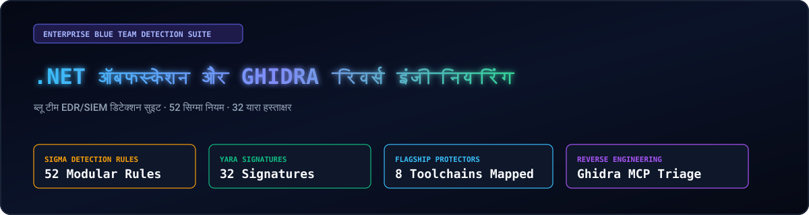
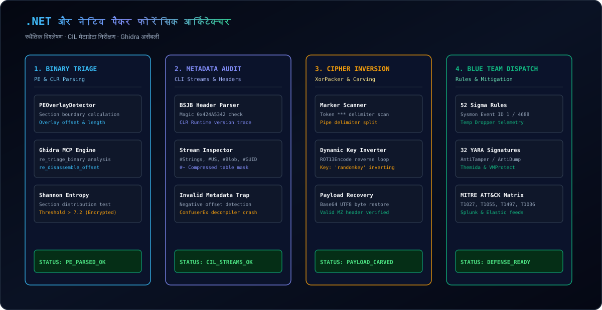
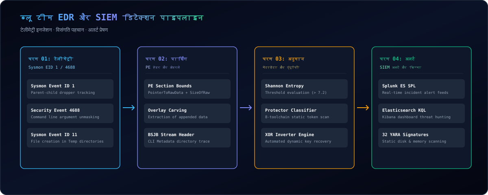

  <a href="../../README.md">🇺🇸 English</a> · <a href="./ko.md">🇰🇷 한국어</a> · <a href="./zh-CN.md">🇨🇳 中文</a> · <a href="./es.md">🇪🇸 Español</a> · <a href="./hi.md">🇮🇳 हिन्दी</a> 
  <a href="./ar.md">🇸🇦 العربية</a> · <a href="./pt-BR.md">🇧🇷 Português</a> · <a href="./ru.md">🇷🇺 Русский</a> · <a href="./fr.md">🇫🇷 Français</a> · <a href="./id.md">🇮🇩 Bahasa Indonesia</a>

  

# 🛡️ dotnet-obfuscation-and-ghidra-re

**ब्लू टीम EDR/SIEM डिटेक्शन इंजीनियरिंग, 52 सिग्मा नियम, 32 यारा हस्ताक्षर और Ghidra रिवर्स इंजीनियरिंग सूट**

Engineered &amp; Audited by **[Maya Thorne](https://github.com/maya-thorne)** · Systems &amp; Reverse Engineering Research

---

## 📌 कार्यकारी अवलोकन

.NET असेंबली CIL और मेटाडेटा में संकलित होती हैं। हमलावर सुरक्षा से बचने के लिए ConfuserEx, .NET Reactor और xorPacker जैसे टूल्स का उपयोग करते हैं।

यह रिपोजिटरी **SOC और EDR विश्लेषकों के लिए एक व्यापक रक्षात्मक रूपरेखा** प्रदान करती है, जिसमें 52 सिग्मा नियम और 32 यारा हस्ताक्षर शामिल हैं।

---

## 🏛️ सिस्टम आर्किटेक्चर और फोरेंसिक पाइपलाइन

  

---

## 🏗️ EDR/SIEM डिटेक्शन पाइपलाइन

  

---

## 💻 टर्मिनल प्रदर्शन

  

---

## 📚 अनुसंधान श्वेतपत्र अनुक्रमणिका

<table width="100%">
  <thead>
    <tr>
      <th width="32%">श्वेतपत्र दस्तावेज</th>
      <th width="68%">तकनीकी दायरा और विश्लेषण लक्ष्य</th>
    </tr>
  </thead>
  <tbody>
    <tr>
      <td>
        🔬 <strong><a href="../whitepapers/01_DOTNET_CIL_METADATA_AND_JIT_FORENSICS.md">01_DOTNET_CIL_METADATA_AND_JIT_FORENSICS.md</a></strong> 
        <code>01_DOTNET_CIL_METADATA_AND_JIT_FORENSICS.md</code>
      </td>
      <td>
        ECMA-335 CIL संरचनाएं, #Strings, #US स्ट्रीम और इनवैलिड मेटाडेटा विश्लेषण।
      </td>
    </tr>
    <tr>
      <td>
        🔬 <strong><a href="../whitepapers/02_CONFUSEREX_8_PHASE_EVASION_DECONSTRUCTION.md">02_CONFUSEREX_8_PHASE_EVASION_DECONSTRUCTION.md</a></strong> 
        <code>02_CONFUSEREX_8_PHASE_EVASION_DECONSTRUCTION.md</code>
      </td>
      <td>
        ConfuserEx AntiTamper JIT हुक्स, AntiDump और कंट्रोल फ्लो डिस्टॉर्शन।
      </td>
    </tr>
    <tr>
      <td>
        🔬 <strong><a href="../whitepapers/03_NATIVE_PACKER_PE_OVERLAY_AND_STUB_RE.md">03_NATIVE_PACKER_PE_OVERLAY_AND_STUB_RE.md</a></strong> 
        <code>03_NATIVE_PACKER_PE_OVERLAY_AND_STUB_RE.md</code>
      </td>
      <td>
        xorPacker ओवरले निष्कर्षण, XOR डिक्रिप्शन और Themida स्टब विश्लेषण।
      </td>
    </tr>
    <tr>
      <td>
        🔬 <strong><a href="../whitepapers/04_COMMERCIAL_OBFUSCATOR_TAXONOMY_AND_HEURISTICS.md">04_COMMERCIAL_OBFUSCATOR_TAXONOMY_AND_HEURISTICS.md</a></strong> 
        <code>04_COMMERCIAL_OBFUSCATOR_TAXONOMY_AND_HEURISTICS.md</code>
      </td>
      <td>
        8 प्रमुख प्रोटेक्टर्स (.NET Reactor, Babel, Eazfuscator) के हस्ताक्षर।
      </td>
    </tr>
  </tbody>
</table>

---

## 🛡️ MITRE ATT&CK रक्षा मैट्रिक्स

Full MITRE ATT&CK matrix: [docs/MITRE_ATTACK_DEFENSE_MATRIX.md](../MITRE_ATTACK_DEFENSE_MATRIX.md)
