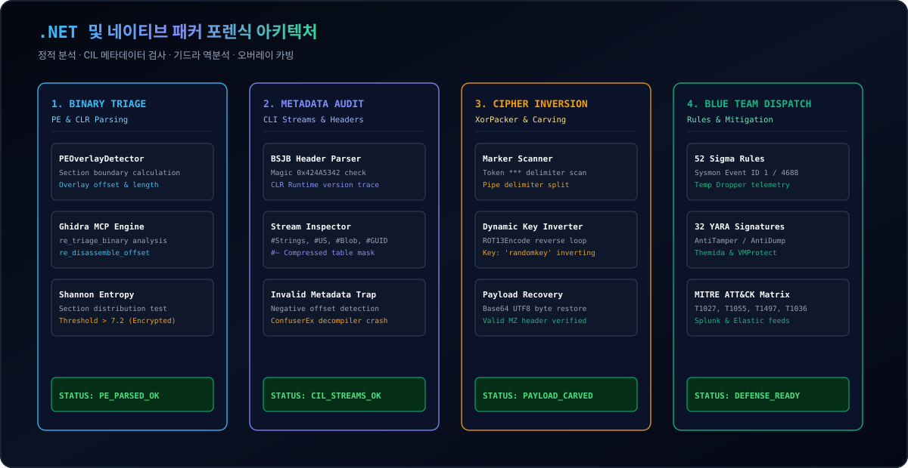
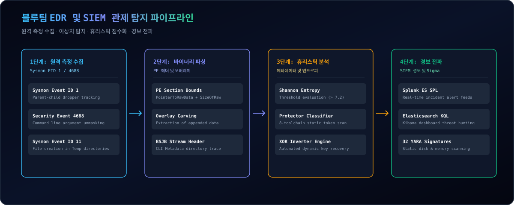

  <a href="../../README.md">🇺🇸 English</a> · <a href="./ko.md">🇰🇷 한국어</a> · <a href="./zh-CN.md">🇨🇳 中文</a> · <a href="./es.md">🇪🇸 Español</a> · <a href="./hi.md">🇮🇳 हिन्दी</a> 
  <a href="./ar.md">🇸🇦 العربية</a> · <a href="./pt-BR.md">🇧🇷 Português</a> · <a href="./ru.md">🇷🇺 Русский</a> · <a href="./fr.md">🇫🇷 Français</a> · <a href="./id.md">🇮🇩 Bahasa Indonesia</a>

  

# 🛡️ dotnet-obfuscation-and-ghidra-re

**블루팀 EDR/SIEM 탐지 엔지니어링, 52개 Sigma 룰, 32개 YARA 룰, CIL 메타데이터 포렌식 및 기드라 역공학 프레임워크**

Engineered &amp; Audited by **[Maya Thorne](https://github.com/maya-thorne)** · Systems &amp; Reverse Engineering Research

---

## 📌 개요 및 연구 목적

.NET 어셈블리는 플랫폼 독립적인 CIL(Common Intermediate Language) 바이트코드와 CLI 메타데이터로 컴파일되어 dnSpy, ILSpy 등의 디컴파일러에 의해 원본 소스코드가 투명하게 노출됩니다. 공격자와 레드팀은 이를 은닉하기 위해 ConfuserEx, .NET Reactor 등의 난독화기와 xorPacker 같은 네이티브 오버레이 인젝터를 악용합니다.

본 저장소는 **블루팀 및 SOC 관제 분석관을 위한 엔터프라이즈 방어 탐지 프레임워크**입니다. 52개의 모듈형 Sigma 룰, 32개의 YARA 시그니처, CIL 메타데이터 이상치 탐지 엔진, 그리고 xorPacker 2단계 XOR 역복호화기를 제공합니다.

---

## 🏛️ 시스템 아키텍처 및 분석 파이프라인

<b>🏛️ 시스템 아키텍처 및 분석 파이프라인 열기/닫기 (클릭하여 접기/펼치기)</b>

 

  

---

## 🏗️ 블루팀 EDR/SIEM 탐지 파이프라인

<b>🏗️ 블루팀 EDR/SIEM 탐지 파이프라인 열기/닫기 (클릭하여 접기/펼치기)</b>

 

  

---

## 💻 대화형 포렌식 터미널 시연

<b>💻 대화형 포렌식 터미널 시연 열기/닫기 (클릭하여 접기/펼치기)</b>

 

  

---

## 📚 핵심 연구 백서 인덱스

<table width="100%">
  <thead>
    <tr>
      <th width="32%">연구 백서 명칭</th>
      <th width="68%">기술 범위 및 분석 대상</th>
    </tr>
  </thead>
  <tbody>
    <tr>
      <td>
        🔬 <strong><a href="../whitepapers/01_DOTNET_CIL_METADATA_AND_JIT_FORENSICS.md">01_DOTNET_CIL_METADATA_AND_JIT_FORENSICS.md</a></strong> 
        <code>01_DOTNET_CIL_METADATA_AND_JIT_FORENSICS.md</code>
      </td>
      <td>
        ECMA-335 CLI 헤더, #Strings, #US, #Blob 스트림 및 Invalid Metadata 크래시 기법 심층 분석.
      </td>
    </tr>
    <tr>
      <td>
        🔬 <strong><a href="../whitepapers/02_CONFUSEREX_8_PHASE_EVASION_DECONSTRUCTION.md">02_CONFUSEREX_8_PHASE_EVASION_DECONSTRUCTION.md</a></strong> 
        <code>02_CONFUSEREX_8_PHASE_EVASION_DECONSTRUCTION.md</code>
      </td>
      <td>
        ConfuserEx의 AntiTamper JIT 후킹, AntiDump 메모리 소거, 제어 흐름 왜곡 소스코드 해체.
      </td>
    </tr>
    <tr>
      <td>
        🔬 <strong><a href="../whitepapers/03_NATIVE_PACKER_PE_OVERLAY_AND_STUB_RE.md">03_NATIVE_PACKER_PE_OVERLAY_AND_STUB_RE.md</a></strong> 
        <code>03_NATIVE_PACKER_PE_OVERLAY_AND_STUB_RE.md</code>
      </td>
      <td>
        xorPacker PE 오버레이 카빙, ROT13/XOR 2단계 역복호화 및 Themida 가상화 스텁 분석.
      </td>
    </tr>
    <tr>
      <td>
        🔬 <strong><a href="../whitepapers/04_COMMERCIAL_OBFUSCATOR_TAXONOMY_AND_HEURISTICS.md">04_COMMERCIAL_OBFUSCATOR_TAXONOMY_AND_HEURISTICS.md</a></strong> 
        <code>04_COMMERCIAL_OBFUSCATOR_TAXONOMY_AND_HEURISTICS.md</code>
      </td>
      <td>
        .NET Reactor, Babel, Eazfuscator, ArmDot 등 8대 상용 난독화기 계통도 및 시그니처.
      </td>
    </tr>
  </tbody>
</table>

---

## 🛡️ MITRE ATT&CK 엔터프라이즈 방어 매트릭스

Full MITRE ATT&CK matrix: [docs/MITRE_ATTACK_DEFENSE_MATRIX.md](../MITRE_ATTACK_DEFENSE_MATRIX.md)
