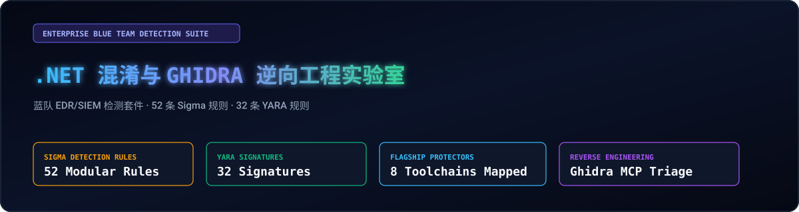
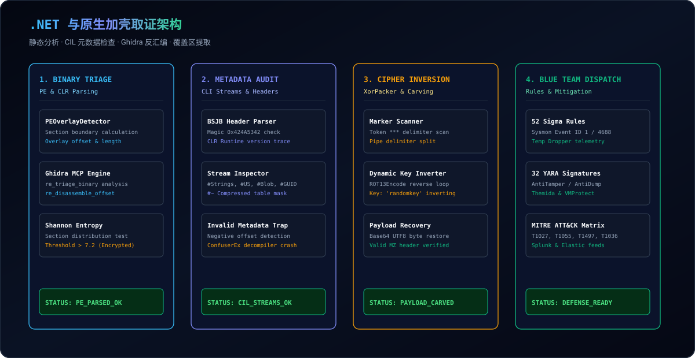
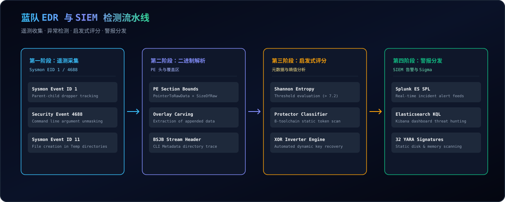

  <a href="../../README.md">🇺🇸 English</a> · <a href="./ko.md">🇰🇷 한국어</a> · <a href="./zh-CN.md">🇨🇳 中文</a> · <a href="./es.md">🇪🇸 Español</a> · <a href="./hi.md">🇮🇳 हिन्दी</a> 
  <a href="./ar.md">🇸🇦 العربية</a> · <a href="./pt-BR.md">🇧🇷 Português</a> · <a href="./ru.md">🇷🇺 Русский</a> · <a href="./fr.md">🇫🇷 Français</a> · <a href="./id.md">🇮🇩 Bahasa Indonesia</a>

  

# 🛡️ dotnet-obfuscation-and-ghidra-re

**蓝队 EDR/SIEM 检测工程、52 条 Sigma 规则、32 条 YARA 规则、CIL 元数据取证及 Ghidra 逆向工程套件**

Engineered &amp; Audited by **[Maya Thorne](https://github.com/maya-thorne)** · Systems &amp; Reverse Engineering Research

---

## 📌 概述与研究目标

.NET 程序集编译为平台独立的 CIL 字节码和 CLI 元数据，使源码极易被反编译。攻击者使用 ConfuserEx、.NET Reactor 和 xorPacker 等原生加壳工具来规避安全检测。

本仓库为**蓝队和 SOC 监控分析师提供企业级防御检测框架**。包含 52 个模块化 Sigma 规则、32 个 YARA 签名、CIL 异常检查引擎以及 xorPacker 双阶段解密器。

---

## 🏛️ 系统架构与分析流水线

  

---

## 🏗️ 蓝队 EDR/SIEM 检测流水线

  

---

## 💻 交互式终端取证演示

  

---

## 📚 核心研究白皮书索引

<table width="100%">
  <thead>
    <tr>
      <th width="32%">白皮书文档</th>
      <th width="68%">技术范围与分析目标</th>
    </tr>
  </thead>
  <tbody>
    <tr>
      <td>
        🔬 <strong><a href="../whitepapers/01_DOTNET_CIL_METADATA_AND_JIT_FORENSICS.md">01_DOTNET_CIL_METADATA_AND_JIT_FORENSICS.md</a></strong> 
        <code>01_DOTNET_CIL_METADATA_AND_JIT_FORENSICS.md</code>
      </td>
      <td>
        ECMA-335 CLI 头、#Strings、#US、#Blob 流及 Invalid Metadata 崩溃机制分析。
      </td>
    </tr>
    <tr>
      <td>
        🔬 <strong><a href="../whitepapers/02_CONFUSEREX_8_PHASE_EVASION_DECONSTRUCTION.md">02_CONFUSEREX_8_PHASE_EVASION_DECONSTRUCTION.md</a></strong> 
        <code>02_CONFUSEREX_8_PHASE_EVASION_DECONSTRUCTION.md</code>
      </td>
      <td>
        ConfuserEx AntiTamper JIT 钩子、AntiDump 内存擦除与控制流平坦化解构。
      </td>
    </tr>
    <tr>
      <td>
        🔬 <strong><a href="../whitepapers/03_NATIVE_PACKER_PE_OVERLAY_AND_STUB_RE.md">03_NATIVE_PACKER_PE_OVERLAY_AND_STUB_RE.md</a></strong> 
        <code>03_NATIVE_PACKER_PE_OVERLAY_AND_STUB_RE.md</code>
      </td>
      <td>
        xorPacker PE 覆盖区提取、双阶段 XOR 逆向解密及 Themida 代码虚拟化分析。
      </td>
    </tr>
    <tr>
      <td>
        🔬 <strong><a href="../whitepapers/04_COMMERCIAL_OBFUSCATOR_TAXONOMY_AND_HEURISTICS.md">04_COMMERCIAL_OBFUSCATOR_TAXONOMY_AND_HEURISTICS.md</a></strong> 
        <code>04_COMMERCIAL_OBFUSCATOR_TAXONOMY_AND_HEURISTICS.md</code>
      </td>
      <td>
        .NET Reactor、Babel、Eazfuscator、ArmDot 等 8 大商业混淆器分类与签名。
      </td>
    </tr>
  </tbody>
</table>

---

## 🛡️ MITRE ATT&CK 企业防御矩阵

Full MITRE ATT&CK matrix: [docs/MITRE_ATTACK_DEFENSE_MATRIX.md](../MITRE_ATTACK_DEFENSE_MATRIX.md)
